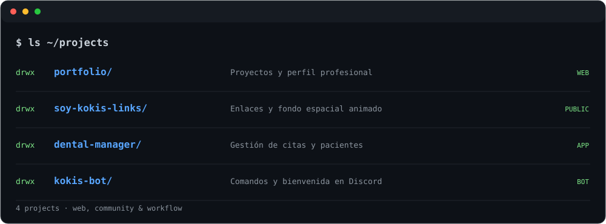
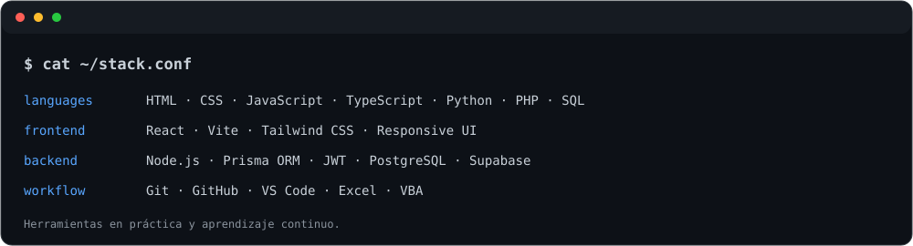
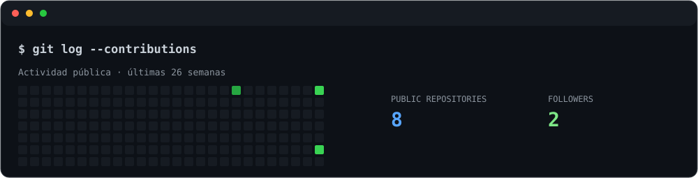

<picture>
  <source media="(max-width: 600px)" srcset="./assets/neofetch-mobile.svg">
  
</picture>

`~/links` &nbsp; [Portfolio](https://jorghdz.dev) · [GitHub](https://github.com/JorgHdzCas) · [LinkedIn](https://www.linkedin.com/in/jorghdz-cas/)

<picture>
  <source media="(max-width: 600px)" srcset="./assets/projects-mobile.svg">
  
</picture>

`~/projects` &nbsp; [Portfolio ↗](https://jorghrndz.dev) · [Soy Kokis Links: código](https://github.com/JorgHdzCas/soy-kokis-links) / [demo ↗](https://soy-kokis-links.vercel.app)

cat ~/projects/README — detalles de los proyectos

| Proyecto | Qué resuelve | Tecnologías |
| :--- | :--- | :--- |
| **Portafolio personal** | Presentación de proyectos, habilidades y contacto profesional. | React · Vite · TypeScript |
| **Soy Kokis Links** | Enlaces por categorías y fondo espacial animado para mi comunidad. | React · Vite · CSS · React Icons |
| **Gestión de clínica dental** | Citas, pacientes, tratamientos, documentos y control de acceso por roles. | React · Tailwind CSS · Prisma · Supabase · JWT |
| **Kokis Bot** | Comandos de consulta y mensajes de bienvenida para LOS KOKITOS. | Node.js · Discord API |

Los enlaces públicos disponibles están arriba. Los repositorios de la clínica y del bot aún no se enlazan aquí.

<picture>
  <source media="(max-width: 600px)" srcset="./assets/skills-mobile.svg">
  
</picture>

<picture>
  <source media="(max-width: 600px)" srcset="./assets/activity-mobile.svg">
  
</picture>

Actividad pública de GitHub; los colores representan niveles de contribuciones. No es una medida de dominio técnico.

`~/contact` &nbsp; Abierto a oportunidades profesionales, colaboraciones y proyectos freelance.

[Conectemos en LinkedIn ↗](https://www.linkedin.com/in/jorghdz-cas/) · [Visita mi portafolio ↗](https://jorghdz.dev)

Jorge Hernández · Build. Learn. Improve.
