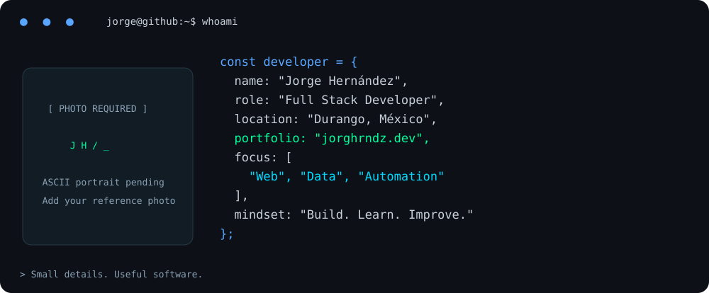
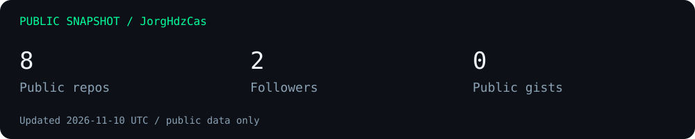

<!-- Edit text here; visual sources and instructions are in INSTALL.md. -->

  <picture>
    <source media="(prefers-reduced-motion: reduce) and (max-width: 600px)" srcset="./assets/header-mobile-static.png">
    <source media="(prefers-reduced-motion: reduce)" srcset="./assets/header-static.png">
    <source media="(max-width: 600px)" srcset="./assets/header-mobile.gif">
    
  </picture>

<a href="https://jorghrndz.dev">Explorar mi portafolio ↗</a> · <a href="#featured-projects">Proyectos</a> · <a href="#connect">Contacto</a>

<picture>
  <source media="(max-width: 600px)" srcset="./assets/hero-mobile.svg">
  
</picture>

## whoami

Soy **Jorge Hernández**, Ingeniero en Sistemas Computacionales. Desarrollo aplicaciones web con React y exploro cómo los datos y la automatización pueden simplificar el trabajo cotidiano.

- **Construyo:** interfaces, aplicaciones y herramientas para problemas reales.
- **Conecto:** frontend, bases de datos y procesos.
- **Aprendo:** desarrollando proyectos, revisando decisiones y cuidando los detalles.

## Tech stack

Herramientas con las que trabajo o que estoy fortaleciendo mediante proyectos; no representan el mismo nivel de dominio.

| Área | Tecnologías |
| :--- | :--- |
| **Languages** |       HTML5 · CSS3 · JavaScript · TypeScript · Python · PHP · SQL |
| **Frontend** |    React · Vite · Tailwind CSS · Responsive design |
| **Backend** |   Node.js · Prisma ORM · JWT |
| **Databases** |   PostgreSQL · Supabase |
| **Tools & Workflow** |    Git · GitHub · VS Code · Excel · VBA |

## Featured projects

<table>
<tr><td>
<h3>01 / Personal portfolio</h3>

Mi espacio para presentar proyectos, habilidades y formas de contacto.

React · Vite · TypeScript

<a href="https://jorghrndz.dev">Ver sitio ↗</a> · Repositorio: <code>[REPO_1]</code>

</td></tr>
</table>

<table>
<tr><td>
<h3>02 / Dental clinic manager</h3>

Sistema de gestión de citas, pacientes, tratamientos, documentos, usuarios y roles.

React · Tailwind CSS · Prisma · Supabase · JWT

Demo: <code>[DEMO_CLINICA]</code> · Repositorio: <code>[REPO_2]</code>

</td></tr>
</table>

<table>
<tr><td>
<h3>03 / Social links</h3>

Página personal de enlaces con categorías y un fondo espacial animado.

React · Vite · CSS · React Icons

<a href="https://soy-kokis-links.vercel.app">Ver demo ↗</a> · <a href="https://github.com/JorgHdzCas/soy-kokis-links">Repositorio ↗</a>

</td></tr>
</table>

<table>
<tr><td>
<h3>04 / Kokis Bot</h3>

Bot de Discord para LOS KOKITOS: comandos de consulta y mensajes de bienvenida.

Node.js · Discord API

Sin demo web; repositorio pendiente. · Repositorio: <code>[REPO_4]</code>

</td></tr>
</table>

<table>
<tr><td>
<h3>05 / Automation lab</h3>

Espacio reservado para documentar herramientas de automatización y seguimiento. Alcance por confirmar.

Excel · VBA

Proyecto por documentar. · Repositorio: <code>[REPO_5]</code>

</td></tr>
</table>

## GitHub analytics

Snapshot local de repositorios públicos, seguidores y gists. Actualizado con los datos públicos de JorgHdzCas; fecha indicada en la imagen. Estas cifras no miden habilidad ni incluyen trabajo privado.

## Connect

Abierto a oportunidades profesionales, colaboraciones y proyectos freelance.

| Canal | Encuéntrame |
| :--- | :--- |
| ↗ Portfolio | [jorghrndz.dev](https://jorghrndz.dev) |
| ⌘ GitHub | [JorgHdzCas](https://github.com/JorgHdzCas) |
| ↗ LinkedIn | [Jorge Hernández](https://www.linkedin.com/in/jorghdz-cas/) |
| ✉ Email | `jorghdz.cas@gmail.com` |

<!-- Reemplaza los marcadores por enlaces reales antes de publicar. -->

<b>Que cada línea acerque una idea a alguien que la necesita.</b> Gracias por visitar mi espacio. — Jorge

